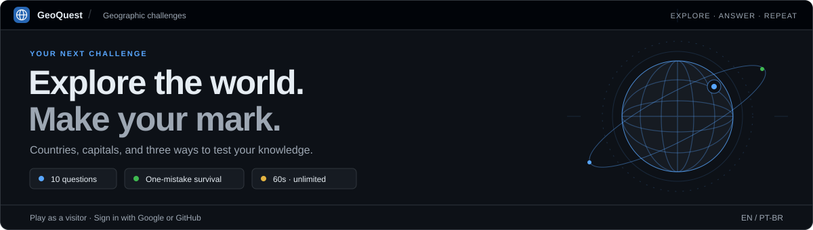
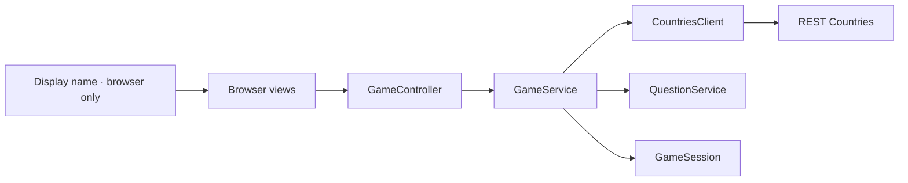

<div align="center">

# GeoQuest

**A browser geography game. Pick a name, explore the world, and enjoy the challenge.**



<br>
<br>


[The game](#the-game) &nbsp;·&nbsp; [Run locally](#run-locally) &nbsp;·&nbsp; [Architecture](#architecture) &nbsp;·&nbsp; [API](#http-api) &nbsp;·&nbsp; [Testing](#testing)

</div>

---

## The game

GeoQuest is a capital-city quiz built with a Java backend and a lightweight HTML, CSS, and JavaScript interface.

| Pick a name | Take the challenge | See your result |
| :--- | :--- | :--- |
| Your name personalizes greetings during the game. | Ten questions. Four choices each. Your first mistake ends the round. | The final screen shows the score for that round. |

### Names are only for greetings

The name is a display preference used for messages such as **“Your turn, Rai.”** and
**“Well done, Rai! Correct answer.”** It does not identify an account or a ranking entry.

- Any player can choose the same name; no uniqueness or name ownership is enforced.
- The name stays in the browser's current JavaScript state. It is not sent to the API or stored in a database, cookie, or browser storage by the application.
- Play again keeps the name. Change player, Home, or reloading the page clears it.
- The form accepts up to 80 Unicode code points after trimming surrounding whitespace, and rejects blank names and control characters.
- User-entered names are rendered with `textContent` so they remain plain text.

### Round rules

- Country and capital data comes from REST Countries.
- Every displayed capital appears at most once within a round, including distractors.
- Java validates answers and calculates the score; the browser submits only the selected answer.
- The correct answer is returned only after a choice is submitted.
- Retrying the same answer returns its original response without counting it twice.
- Rounds remain in server memory until shutdown; scores are shown for the current round and are not persisted.

The interface is in English, uses a responsive blue design, supports **A–D to answer** and
**Space to continue**, restores keyboard focus after requests, and respects reduced-motion preferences.

There is no global leaderboard, registration, authentication, or persistent player profile.
The former ranking, result-saving routes, database layer, administrative terminal, and PostgreSQL
tests have been removed. Existing databases from earlier versions are untouched; this application
no longer connects to them.

## Run locally

### What you need

| Dependency | Used for |
| :--- | :--- |
| **JDK 25** | Compiling and running the Java backend |
| **Maven** | Dependencies, compilation, and Java tests |
| **REST Countries API key** | Loading the country catalog |
| **Node.js** · optional | Running the front-end tests with its built-in test runner |

Run commands from the project directory containing [`pom.xml`](pom.xml). Java serves both
the browser files and the API; no front-end build or `npm install` is required.

### 01 — Configure once

Java reads a local `.env` beside `pom.xml`. For a new checkout, copy
[`.env.example`](.env.example) and enter your API key:

```powershell
if (-not (Test-Path .env)) { Copy-Item .env.example .env }
notepad .env
```

```dotenv
API_KEY=your-rest-countries-api-key
```

Explicit process or IDE environment variables override the file. Keep `.env` local: Git ignores it,
while `.env.example` contains a placeholder only. Existing `DATABASE_*` entries from an older local
configuration are unused by the game and may be removed from that local file.

The file accepts plain `NAME=value` entries, blank lines, and full-line `#` comments. Optional matching
quotes preserve spaces. Values are literal, with no variable expansion, inline comments, or multiline
syntax. Duplicate or malformed entries report a line number without printing their values.

### 02 — Start the game

```powershell
mvn compile exec:java "-Dexec.mainClass=com.raibrs.geoquest.WebApp"
```

Open **[localhost:8080](http://localhost:8080)** when the startup message appears. Keep the terminal
running; press `Ctrl+C` to stop. Restart the server after Java changes and refresh with `Ctrl+F5`
after browser-file changes. Opening the HTML through the IDE's static preview does not provide the API.

When upgrading from the version with ranking, first stop the old server and run `mvn clean test`
to remove obsolete compiled classes. Start the updated `WebApp`, then refresh the browser.

## Architecture

**Models protect game state. Services coordinate rounds. Controllers handle HTTP. Views render the interface.**



| Part | Responsibility |
| :--- | :--- |
| `WebApp` | Wires dependencies, registers handlers, and manages the HTTP server lifecycle. |
| `controller/` | Reads JSON requests and selects game operations. |
| `http/` | Shares JSON handling, error responses, and cleanup; serves an explicit static-file allowlist. |
| `dto/` | Defines anonymous API input and output records. |
| `model/` | Represents countries, questions, and sessions; owns scoring and answer transitions. |
| `service/` | Creates questions, coordinates rounds, and preserves answer retry behavior. |
| `config/` and `api/` | Load the API key from local/environment settings and fetch country data. |

The HTTP server comes from the JDK and JSON uses Jackson. Dependency wiring is explicit Java.

The front end separates structure, presentation, and interaction. `index.html` defines the three
screens and shared markup; HTML classes connect elements to external styles. `styles.css` imports
base, layout, reusable component, and screen-specific styles. `src/app.js` initializes the controller,
which owns browser state, request sequencing, retries, and navigation. Views update the DOM and bind
input events; `service/game-service.js` handles HTTP communication without accessing the DOM.

The browser keeps one document so changing screens preserves the active round. Java sessions use
random `gameId` values and contain no display name. The Java static-file allowlist explicitly includes
each public module and stylesheet; test files and local configuration stay inaccessible through HTTP.

<details>
<summary><strong>Explore the source tree</strong></summary>

```text
frontend/
├── index.html
├── assets/geoquest-icon.svg
├── styles.css                 # Stylesheet entry point
├── styles/
│   ├── base.css
│   ├── layout.css
│   ├── components.css
│   └── pages/                 # welcome.css, game.css, result.css
├── src/
│   ├── app.js                 # Initialization only
│   ├── controller/game-controller.js
│   ├── service/game-service.js
│   └── view/
│       ├── dom.js
│       ├── shell-view.js
│       └── pages/             # welcome-view.js, game-view.js, result-view.js
└── tests/
src/main/java/com/raibrs/geoquest/
├── WebApp.java
├── controller/
├── http/
├── dto/
├── model/
├── service/
├── config/
└── api/
src/test/java/com/raibrs/geoquest/
├── WebAppTest.java
├── controller/
├── http/
├── model/
├── service/
├── api/
├── config/
└── support/
```

</details>

## HTTP API

Routes use the same origin as the browser page. Request bodies must use `Content-Type: application/json`.

| Method | Endpoint | Request | Result |
| :--- | :--- | :--- | :--- |
| `POST` | `/api/games` | `{}` | Creates an anonymous round and returns its first question. |
| `POST` | `/api/answers` | `gameId`, `number`, `choice` | Checks the answer and returns updated state. |

The start request is an empty JSON object. Display names are not accepted as API fields.
The former `/api/ranking` and `/api/results` routes return `404`.

```http
POST /api/games
Content-Type: application/json

{}
```

The response includes a `gameId`, question number, total, score, finished flag, and question alternatives.
It contains neither a name nor an answer key. When a round ends, the answer response already contains
the final server-calculated score; the browser displays it without another request.

## Testing

| Suite | Command | External services |
| :--- | :--- | :--- |
| Java unit and local HTTP tests | `mvn test` | No production credentials or external service needed. |
| Browser logic and API communication | `node --test frontend/tests/*.test.js` | No browser or network service needed. |

Tests cover anonymous independent rounds, scoring, first-mistake termination, answer replay, JSON
contracts, English errors, and public static-file access. They also verify that the former ranking
routes are unavailable. Front-end checks cover greeting-only names, plain-text rendering, keyboard
navigation, focus restoration, player reset, and retries without sending the display name to Java.
Front-end behavior tests use a minimal DOM adapter; visual and native keyboard checks use a browser.

## Troubleshooting

| Symptom | What to check |
| :--- | :--- |
| Missing `API_KEY` setting | Fill in `.env` beside `pom.xml`; explicit process/IDE variables take precedence. |
| `404` from `/api/games` on port 63342 | Start `WebApp` and open `localhost:8080` instead of the IDE's static preview. |
| `405` when opening `/api/games` directly | This is a POST API route. Open the home page and use Start playing. |
| Port 8080 is already in use | Stop the previous server before starting the current `WebApp`. |
| Missing icon, CSS, or JavaScript module | Restart Java to load the current static-file allowlist, then refresh with `Ctrl+F5`. |
| Countries cannot be loaded | Check the REST Countries API key and network availability, then retry. |
| `frontend/index.html` not found | Run from the directory containing `pom.xml`. |

## Roadmap

- [x] Browser MVP with real country data and Java-controlled scoring.
- [x] Display names used only for browser greetings.
- [x] Separate controllers, views, API service, and styles.
- [x] Responsive blue interface, keyboard access, and reduced-motion support.
- [x] Anonymous rounds with no database dependency or global ranking.
- [ ] Refine feedback, transitions, and question types.
- [ ] Add session cleanup and improve concurrency before public hosting.
- [ ] Expand language support.

The current server binds to `127.0.0.1`, serializes game operations, and retains rounds until shutdown.
Public hosting also needs concurrency and abuse-prevention work. Open, account-free play remains a product decision.

---

<div align="center">

**Learn the world. Build with Java.**

<sub>A learning project developed by Rai Barros</sub>

</div>
