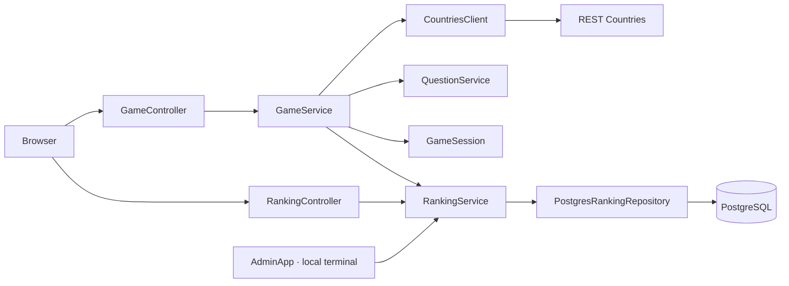

<div align="center">

# GeoQuest

**A browser geography game. Pick a name, explore the world, and leave your mark.**


<br>
<br>


[The game](#the-game) &nbsp;·&nbsp; [Run locally](#run-locally) &nbsp;·&nbsp; [Architecture](#architecture) &nbsp;·&nbsp; [API](#http-api) &nbsp;·&nbsp; [Administration](#local-administration) &nbsp;·&nbsp; [Testing](#testing)

</div>

---

## The game

GeoQuest is a capital-city quiz built with a Java backend and a lightweight HTML, CSS, and JavaScript interface. Enter a name, answer the questions, and see how far you can go.

| Pick a name | Take the challenge | Leave your mark |
| :--- | :--- | :--- |
| No accounts, passwords, or sign-up. | Ten questions. Four choices each. Your first mistake ends the round. | Your best score stays in PostgreSQL. The leaderboard shows the Top 10. |

**Names are signatures, not accounts.** `Rai`, `rai`, and `RAI` share the same ranking entry. Different people can use the same name; only that name's best result is kept.

- Real country data comes from REST Countries.
- Every displayed capital appears at most once within a round, including distractors.
- Java validates answers and calculates the score; the browser never submits a score.
- The correct answer is returned only after a choice is submitted.
- Network retries do not count the same answer twice or rewrite an already saved round.

> **Current release:** a functional local MVP. Visual styling and game-flow improvements are next. Authentication is outside the game's scope.

## Run locally

### What you need

| Dependency | Used for |
| :--- | :--- |
| **JDK 25** | Compiling and running the Java backend |
| **Maven** | Dependencies, compilation, and Java tests |
| **PostgreSQL** | Persistent ranking; tested with version 18 |
| **REST Countries API key** | Loading the country catalog |
| **Node.js** · optional | Running the front-end tests with its built-in test runner |

Run commands from the project directory containing [`pom.xml`](pom.xml). No front-end build, Python server, or `npm install` is required.

### 01 — Prepare the database

For a new installation, open **psql** as a PostgreSQL administrator:

```sql
CREATE ROLE geoquest LOGIN;
\password geoquest
CREATE DATABASE "GeoQuestDB" OWNER geoquest;
```

`\password` is a psql command that prompts for the password. Then apply the existing migrations:

```powershell
psql -h localhost -U geoquest -d GeoQuestDB --single-transaction -v ON_ERROR_STOP=1 -f src/main/resources/db/migration/V1__create_ranking_entries.sql -f src/main/resources/db/migration/V2__validate_player_names.sql
```

<details>
<summary><strong>Already have a database, or cannot find psql?</strong></summary>

- If the database already exists, skip its creation. Use its actual name in the JDBC URL.
- An IntelliJ connection label may differ from the database name in its JDBC URL.
- If V1 has already been applied, run only V2 with the same psql options.
- V2 validates existing names without truncating, renaming, or resetting records.
- On Windows, psql is normally available under `C:\Program Files\PostgreSQL\18\bin\psql.exe`. In PowerShell, invoke a quoted executable path with `&`.
- The application verifies the schema at startup; it does not create databases or run migrations automatically.

</details>

### 02 — Configure the environment

Replace the sample values with your local settings, then run these assignments in **the same PowerShell session** that will start the application:

```powershell
$env:DATABASE_URL="jdbc:postgresql://localhost:5432/GeoQuestDB"
$env:DATABASE_USER="geoquest"
$env:DATABASE_PASSWORD="your-database-password"
$env:API_KEY="your-rest-countries-api-key"
```

| Variable | Meaning | Required by |
| :--- | :--- | :--- |
| `DATABASE_URL` | PostgreSQL address in JDBC format | Web app and administration |
| `DATABASE_USER` | Database login | Web app and administration |
| `DATABASE_PASSWORD` | Database password | Web app and administration |
| `API_KEY` | REST Countries credential | Web app only |

> **Session settings:** closing PowerShell loses these `$env:` assignments. Variables in an IntelliJ run configuration do not automatically reach another terminal. The application reads process environment variables; it does **not** automatically load `.env` files.

Keep credentials out of source code and Git. Local `.env` variants are ignored; example files should contain placeholders only. Put credentials in their separate variables, not inside `DATABASE_URL`.

<details>
<summary><strong>Using Bash instead?</strong></summary>

```bash
export DATABASE_URL="jdbc:postgresql://localhost:5432/GeoQuestDB"
export DATABASE_USER="geoquest"
export DATABASE_PASSWORD="your-database-password"
export API_KEY="your-rest-countries-api-key"
```

Start the application from that same shell using the command below.

</details>

### 03 — Start the game

```powershell
mvn compile exec:java "-Dexec.mainClass=com.raibrs.geoquest.WebApp"
```

Open **[localhost:8080](http://localhost:8080)** when the startup message appears. Keep the terminal running; press `Ctrl+C` to stop.

Java serves both the browser files and the API. If a previous Python server is still using port 8080, stop it first. Existing ranking records are preserved.

<details>
<summary><strong>Check the connection without starting the game</strong></summary>

```powershell
mvn compile exec:java "-Dexec.mainClass=com.raibrs.geoquest.config.DatabaseCheck"
```

The read-only diagnostic prints the actual database, database user, server address, port, and readiness of migrations V1 and V2. It does not print passwords or change ranking records.

To also require an exact database name:

```powershell
mvn compile exec:java "-Dexec.mainClass=com.raibrs.geoquest.config.DatabaseCheck" "-Dexec.args=GeoQuestDB"
```

</details>

## Architecture

**Models protect game state. Services coordinate operations. Controllers handle HTTP. Repositories handle persistence.**



| Part | Responsibility |
| :--- | :--- |
| `WebApp` | Wires dependencies, registers handlers, and manages the HTTP server lifecycle. |
| `controller/` | Reads requests and selects game or ranking operations. |
| `http/` | Shares JSON handling, error responses, and cleanup; serves an explicit allowlist of static files. |
| `dto/` | Defines the API's plain input and output records. |
| `model/` | Represents countries, questions, sessions, and results; owns valid state and answer transitions. |
| `service/` | Creates questions, coordinates rounds and retries, and performs ranking operations. |
| `repository/` | Defines the persistence contract and implements PostgreSQL access through JDBC. |
| `config/` and `api/` | Configure and inspect the database; fetch and parse country data. |

The HTTP server comes from the JDK. JSON uses Jackson, and persistence uses JDBC. Dependency wiring is explicit Java, with no Spring dependency.

<details>
<summary><strong>Explore the source tree</strong></summary>

```text
frontend/
├── index.html
├── styles.css
├── src/
│   ├── app.js
│   └── service/game-service.js
└── tests/
src/main/java/com/raibrs/geoquest/
├── WebApp.java
├── AdminApp.java
├── controller/
├── http/
├── dto/
├── model/
├── service/
├── repository/
├── config/
└── api/
src/main/resources/db/migration/
├── V1__create_ranking_entries.sql
└── V2__validate_player_names.sql
src/test/java/com/raibrs/geoquest/
├── WebAppTest.java             # Application wiring and cross-component HTTP flow
├── AdminAppTest.java           # Local maintenance interaction
├── controller/                # Game and ranking HTTP contracts
├── http/                      # Static asset handler behavior
├── model/                     # Domain state and invariants
├── service/                   # Operation coordination and business rules
├── repository/                # Real PostgreSQL integration
├── api/                       # Country client and parser
├── config/                    # Database configuration validation
└── support/                   # Shared HTTP server and controlled dependencies
scripts/test-postgres.ps1
```

</details>

## HTTP API

All routes use the same origin as the browser page. POST bodies must use `Content-Type: application/json`.

| Method | Endpoint | Request | Result |
| :--- | :--- | :--- | :--- |
| `POST` | `/api/games` | `playerName` | Creates a round and returns its first question. |
| `POST` | `/api/answers` | `gameId`, `number`, `choice` | Checks the answer and returns updated state. |
| `POST` | `/api/results` | `gameId` | Saves the completed round's server-calculated result. |
| `GET` | `/api/ranking` | — | Returns the Top 10. |

<details>
<summary><strong>Example: starting a round</strong></summary>

```http
POST /api/games
Content-Type: application/json
```

```json
{
  "playerName": "Rai"
}
```

The response includes a `gameId`, progress, score, and question alternatives. It does not include the unanswered question's correct answer.

</details>

## Ranking and game data

On **Ver resultado**, the browser asks Java to save the completed round and load the Top 10. **Trocar jogador** sets the name for future rounds.

| Rule | Behavior |
| :--- | :--- |
| Best result | One result per case-insensitive name. A lower score cannot replace a higher one. |
| Ties | More recent results come first. An equal score for the same name refreshes its timestamp. |
| Stable ordering | If score and timestamp match, the normalized name breaks the tie. |
| Names | Trimmed; at most 80 Unicode code points; no control characters. Display capitalization and accents are retained. |
| Storage | Players outside the Top 10 remain in the database. |
| Concurrency | An atomic `INSERT ... ON CONFLICT` protects each name's best result. |
| Save retry | The completed score and its original timestamp stay in server memory for another attempt. |
| Ranking read failure | A failure after a successful save does not cause another database write. |

**Country catalog.** REST Countries is loaded in pages of 80 on the first round and cached only after every page succeeds. New rounds shuffle new questions from the cached catalog. A failed fetch can be retried manually; restarting the server refreshes the cache.

**Session lifetime.** Rounds and unsaved results live in server memory. Restarting the server loses them; reloading the browser loses its reference to the round. Saved ranking results remain in PostgreSQL.

## Local administration

The game runs in the browser. A separate terminal handles local maintenance:

```powershell
mvn compile exec:java "-Dexec.mainClass=com.raibrs.geoquest.AdminApp"
```

It uses the database variables above and does not need `API_KEY`.

| Action | Behavior |
| :--- | :--- |
| Check database | Shows connection and schema diagnostics. |
| Rename ranking entry | Asks for the current name, new name, and explicit `SIM` confirmation. |

Renaming uses one atomic `UPDATE`. It preserves the score, question count, and timestamp; allows case-only changes; and rejects occupied names without merging players. No new migration is needed.

> **Maintenance procedure:** stop the web server before renaming. Active rounds remember the old name and could recreate it when saved. The terminal warns about this requirement; it does not lock the server.

This tool trusts the local operator with database credentials. It does not list other players, expose an administrative HTTP route, or establish ownership of a name. It is not a private profile editor.

## Testing

| Suite | Command | External services |
| :--- | :--- | :--- |
| Java unit and local HTTP tests | `mvn test` | No production credentials or PostgreSQL needed. |
| Browser logic and API communication | `node --test frontend/tests/*.test.js` | No browser or network service needed. |
| PostgreSQL integration | `.\scripts\test-postgres.ps1` | Uses installed PostgreSQL binaries to start an isolated instance. |

Tests cover round termination, scoring, request replay, save retries, JSON contracts, administrative confirmation and cancellation, and preservation of ranking results. Front-end behavior tests use a minimal DOM adapter; they do not replace a visual review in a browser.

Test packages follow the component they exercise. `controller/` tests each controller over local
HTTP with controlled dependencies, while `http/` verifies static file access. `WebAppTest` keeps
the application-wiring checks and the play → save → ranking flow. `support/TestHttpServer`
shares transport setup and cleanup through composition; it contains no game assertions.

The Windows PostgreSQL helper starts a temporary cluster on a free loopback port, runs `postgres-integration`, and stops the cluster in `finally`. It uses dummy credentials and trust authentication only for this disposable instance. It does not access the installed PostgreSQL service or existing databases. Data and logs stay under ignored `target/postgres-test-*` directories.

Running `PostgresRankingRepositoryIT` directly in an IDE requires `TEST_DATABASE_URL`,
`TEST_DATABASE_USER`, and the appropriate `TEST_DATABASE_PASSWORD` in that test's run configuration.
The application's `DATABASE_*` variables are separate. The helper supplies its temporary settings
only to its own Maven run and restores the previous values when finished; those settings do not
configure a later IDE run. Use the helper to run against an automatically prepared temporary database.

<details>
<summary><strong>Custom PostgreSQL installation or a separate test database</strong></summary>

Specify another installation path:

```powershell
.\scripts\test-postgres.ps1 -PostgresBin "C:\Program Files\PostgreSQL\18\bin"
```

Or configure a dedicated test database with a login allowed to create schemas:

```powershell
$env:TEST_DATABASE_URL="jdbc:postgresql://localhost:5432/geoquest_test"
$env:TEST_DATABASE_USER="geoquest_test"
$env:TEST_DATABASE_PASSWORD="your-test-password"

mvn -Ppostgres-integration test
```

Integration tests create and remove only their own randomly named schema. The profile fails if the required test connection settings are missing. Never point test settings at your production database.

</details>

## Troubleshooting

| Symptom | What to check |
| :--- | :--- |
| `Set the DATABASE_URL environment variable` | Set the environment variables in the same terminal that launches Maven. |
| `Set TEST_DATABASE_URL and TEST_DATABASE_USER` | Run `.\scripts\test-postgres.ps1` from the project directory, or configure `TEST_DATABASE_*` for a dedicated test database in the terminal or IDE running the integration test. |
| `501 Unsupported method ('POST')` | Stop the old static server and launch `WebApp`; Java must serve both the page and the API. |
| Port 8080 is already in use | Stop the process currently serving that port before starting the game. |
| Ranking schema is missing or not ready | Check the actual database name and apply the required V1/V2 migrations. |
| Countries cannot be loaded | Check the REST Countries key and network availability, then retry. |
| `frontend/index.html` not found | Run from the directory containing `pom.xml`. |

## Roadmap

- [x] Browser MVP with real country data.
- [x] Java-controlled scoring and PostgreSQL ranking.
- [x] Layered backend with explicit controllers and shared HTTP handling.
- [x] Local ranking maintenance and automated tests.
- [ ] Refine the front-end visual design.
- [ ] Improve feedback, transitions, and game flow.
- [ ] Expand question types and language support.

The current server binds to `127.0.0.1`, serializes game operations, and retains rounds until shutdown. Public hosting needs session cleanup and concurrency/abuse-prevention work. Open, account-free play remains a product decision.

---

<div align="center">

**Learn the world. Build with Java.**

<sub>A learning project developed by Rai Barros</sub>

</div>
