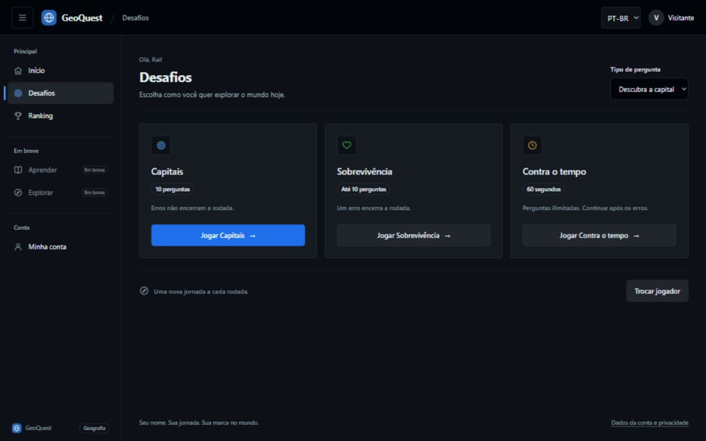
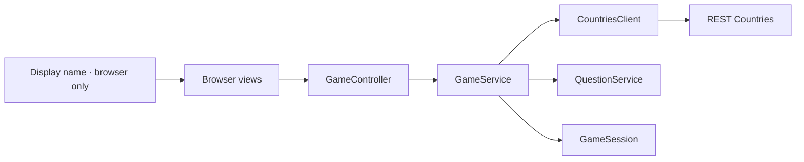

<div align="center">

# GeoQuest

**A browser geography game. Pick a name, explore the world, and enjoy the challenge.**


<br>
<br>


[The game](#the-game) &nbsp;·&nbsp; [Run locally](#run-locally) &nbsp;·&nbsp; [Architecture](#architecture) &nbsp;·&nbsp; [API](#http-api) &nbsp;·&nbsp; [Testing](#testing)

</div>

---

## The game

GeoQuest is a capital-city quiz built with a Java backend and a lightweight HTML, CSS, and JavaScript interface.

| Pick a name | Take the challenge | See your result |
| :--- | :--- | :--- |
| Your name personalizes greetings in the hub and game. | Choose Capitals, Survival, or Against the clock. | The final screen shows the score for that round. |

### Visitor names are only for greetings

The name is a display preference used for messages such as **“Your turn, Rai.”** and
**“Well done, Rai! Correct answer.”** For visitors, it does not identify an account or a ranking entry. Signed-in players use the provider profile name.

- Any player can choose the same name; no uniqueness or name ownership is enforced.
- The visitor name stays in the browser's current JavaScript state. It is not sent to the API or stored in a database, cookie, or browser storage by the application.
- Play again keeps the name and selected mode. Back to hub and the header's Home button keep the name; the visitor Logout button or reloading the page clears it.
- The form accepts up to 80 Unicode code points after trimming surrounding whitespace, and rejects blank names and control characters.
- User-entered names are rendered with `textContent` so they remain plain text.

### Languages and question types

Use the header selector to choose English or Brazilian Portuguese before a round. The choice
applies to interface text, greetings, feedback, and Java-generated prompts, and stays fixed during
the round. Country names use Portuguese API translations with an ISO/Java locale fallback. Capital names
use a bundled Portuguese catalog sourced from Wikidata with Brazilian spellings and aliases.
Names are localized before generating questions, including all distractors in both question directions.
Entries without complete localization are excluded from Portuguese rounds instead of falling back
to English. The real catalog audit on 2026-10-28 covered all 249 entries with a capital.
See [catalog provenance](src/main/resources/localization/README.md) for sources and maintenance.
The hub offers **Find the capital** (default) and **Find the country** in all three modes.
Country questions exclude shared capitals to avoid ambiguous correct answers.
At the end of a round, **See where I went wrong / Veja onde eu errei** lists each incorrect
question, the submitted answer, and the correct answer. Review data is provided only for finished
rounds and is kept in session memory. Retries do not duplicate errors; unanswered questions are
not counted as mistakes. A round without mistakes displays a clear empty state.

The final ten seconds show a warning; results distinguish perfect rounds, survival endings, and timeouts.
Screen transitions respect reduced-motion preferences.

### Round rules

The hub offers three modes, all using world-capital questions:

| Mode | Rules |
| :--- | :--- |
| Capitals (`CAPITALS`) | Answer all 10 questions, continuing after mistakes. |
| Survival (`SURVIVAL`) | Up to 10 questions; the first mistake ends the round. |
| Against the clock (`TIMED`) | Unlimited questions for 60 seconds, continuing after mistakes. The Java server enforces the deadline. |

Timed rounds load fresh batches as needed, keep the original deadline, and have no question limit.
Questions and alternatives can repeat across batches when drawing again from the finite country catalog.
Their progress bar shows remaining time; their result reports correct and submitted answers without a fixed denominator.
The API returns `total: null` for timed rounds and an `answered` count for every mode.

Each correct answer earns one point. Answered-question progress is separate from the score.
Returning to the hub leaves the current round; choosing a mode starts a new round.
Timed rounds show their result when the deadline is reached, even without submitting an answer.

- Country and capital data comes from REST Countries.
- Every displayed capital appears at most once within a round, including distractors.
- Java validates answers and calculates the score; the browser submits only the selected answer.
- The correct answer is returned only after a choice is submitted.
- Retrying the same answer returns its original response without counting it twice.
- When a round ends, choose **Play again** directly from the answer screen or **View result**.
- On the answer screen, **R** restarts a finished round with the same greeting name, while **Space** opens its result.
- Rounds stay in server memory: idle rounds expire after 30 minutes, and finished rounds are retained for 5 minutes to support network retries. Completed signed-in results are persisted; visitor scores are not.

The interface supports English and Brazilian Portuguese, uses a responsive dark design, supports **A–D to answer** and
**Space to continue**, restores keyboard focus after requests, and respects reduced-motion preferences.

### Mobile and tablet browsers

The same web application adapts to phones, tablets, and desktop browsers. On narrow screens,
mode cards and answer buttons stack vertically; tablets use three mode cards and two answer
columns when space permits. Short landscape screens retain two answer columns.
Controls have touch targets of at least 44 px, inputs use a readable 16 px font on touch devices,
and page padding accounts for display cutouts. Keyboard shortcuts remain available; their visual
hint is hidden on phones and touch devices. The timed warning has reserved space so it does not
move the answers when the final ten seconds begin.

This is a responsive browser interface. See [responsive verification](docs/RESPONSIVE_QA.md)
for tested viewports and remaining device checks.

### Application interface

GeoQuest uses a GitHub Dark-inspired application shell with its own blue identity: a fixed header,
collapsible desktop sidebar, and an accessible mobile/tablet drawer. Home, Challenges, Ranking,
and My account share the same document; the existing controller switches views without a router.
Ranking and account management have dedicated areas, leaving the challenge hub focused on play.
Learn and Explore are disabled **Coming soon** entries; they have no pages, data, or API calls.



Semantic color tokens live in `frontend/styles/tokens.css`. The shell owns navigation and drawer
focus; account views render profile/ranking data as plain text; controllers keep orchestration and
the existing HTTP service retains CSRF handling. See [redesign decisions and validation](docs/REDESIGN.md).

### Optional accounts and ranking

Sign in with Google or GitHub through Spring Security OAuth2 Client to keep a profile and completed results in PostgreSQL.
The hub shows a top-20 ranking filtered by mode and question type, with each player's best result.
A recently signed-in player can delete their GeoQuest account, sessions and results using the
confirmation form. Visitor rounds remain available and do not enter the ranking.

Accounts are opt-in with `ACCOUNTS_ENABLED=true`; only configured providers are shown.
Apply `database/001_accounts.sql` and `database/002_oauth_profile.sql` before enabling them. Existing
profiles, scores and seven-day database sessions are preserved. See
[Render + Neon deployment](docs/DEPLOYMENT.md) for credentials, provider callbacks, security behavior,
local database tests and the public deployment checklist. All identity secrets remain on the Java server.

## Run locally

### What you need

| Dependency | Used for |
| :--- | :--- |
| **JDK 25** | Compiling and running the Java backend |
| **Maven** | Dependencies, compilation, and Java tests |
| **REST Countries API key** | Loading the country catalog |
| **Node.js** · optional | Running the front-end tests with its built-in test runner |

Run commands from the project directory containing [`pom.xml`](pom.xml). Java serves both
the browser files and the API; no front-end build or `npm install` is required.

### 01 — Configure once

Java reads a local `.env` beside `pom.xml`. For a new checkout, copy
[`.env.example`](.env.example) and enter your API key:

```powershell
if (-not (Test-Path .env)) { Copy-Item .env.example .env }
notepad .env
```

```dotenv
API_KEY=your-rest-countries-api-key
```

Explicit process or IDE environment variables override the file. Keep `.env` local: Git ignores it,
while `.env.example` contains placeholders only. Database and OAuth settings are used only when
accounts are enabled; visitor mode needs only the country API key.

The file accepts plain `NAME=value` entries, blank lines, and full-line `#` comments. Optional matching
quotes preserve spaces. Values are literal, with no variable expansion, inline comments, or multiline
syntax. Duplicate or malformed entries report a line number without printing their values.

### 02 — Start the game

```powershell
mvn spring-boot:run
```

Open **[localhost:8080](http://localhost:8080)** when the startup message appears. Keep the terminal
running; press `Ctrl+C` to stop. Restart the server after Java changes and refresh with `Ctrl+F5`
after browser-file changes. Opening the HTML through the IDE's static preview does not provide the API.

## Run with Docker

Run these commands from the folder containing `pom.xml` and `Dockerfile`:

```powershell
docker build -t geoquest .
docker run --rm --name geoquest -p 127.0.0.1:8080:8080 --mount "type=bind,source=${PWD}\.env,target=/app/.env,readonly" geoquest
```

Open http://localhost:8080. Stop with Ctrl+C. Docker Desktop must be running in Linux-container mode.
The image builds and runs Java tests in a Maven/JDK 25 stage, then copies the application JAR,
localization resources and frontend to a Java 25 JRE image. Runtime dependencies are inside the
executable Spring Boot JAR, launched with `java -jar app.jar`. It runs as a
non-root user. Tests do not call the real country API.

The local `.env` never enters the build context or image. The local command mounts it read-only at
runtime so Java's existing parser handles optional quotes consistently. For public hosting, use the
platform's environment settings. As an alternative, Docker's `--env-file` accepts a separate file
with unquoted `NAME=value` entries: Docker preserves quotes as part of the value.

The image sets `HOST=0.0.0.0` and `PORT=8080` so published ports can reach Java. For a custom
container port, change both the environment and the port mapping:

```powershell
docker run --rm --name geoquest -p 127.0.0.1:8081:10000 --mount "type=bind,source=${PWD}\.env,target=/app/.env,readonly" -e HOST=0.0.0.0 -e PORT=10000 geoquest
```

Without Docker, the defaults remain `HOST=127.0.0.1` and `PORT=8080`. Invalid ports fail at startup.
The image runs frontend and API together. On a hosting platform, configure the listening port and
`API_KEY`; no local `.env` is needed. PostgreSQL and OAuth settings are required only when enabling accounts. Keep one instance while sessions are in memory.
Docker packaging does not make sessions shared: deploying this container to Vercel Functions still
requires shared session storage to handle requests across instances. Restarts discard active rounds.

## Architecture

**Models protect game state. Services coordinate rounds. Controllers handle HTTP. Views render the interface.**



| Part | Responsibility |
| :--- | :--- |
| `WebApp` | Wires dependencies, registers handlers, and manages the HTTP server lifecycle. |
| `controller/` | Reads JSON requests and selects game operations. |
| `account/` | Handles provider sign-in, cookie sessions, PostgreSQL profiles, ranking, and deletion. |
| `http/` | Shares JSON handling, error responses, and cleanup; serves an explicit static-file allowlist. |
| `dto/` | Defines anonymous API input and output records. |
| `model/` | Represents countries, questions, and sessions; owns scoring and answer transitions. |
| `service/` | Creates questions, coordinates rounds, and preserves answer retry behavior. |
| `config/` and `api/` | Load the API key from local/environment settings and fetch country data. |

Spring Boot 3.5.16 starts embedded Tomcat and wires the existing Java services through constructor
injection and explicit beans. Spring MVC handles JSON/HTTP, Jackson handles serialization, and
Spring Security 6.5.11 handles OAuth2/OIDC, state, nonce, PKCE and CSRF. Domain rules remain plain Java.
`PersistentSessionFilter` loads the existing hashed database session once for an authenticated API
request. The framework's temporary session is only for the login handshake and is discarded afterward.
No JWT or Basic Auth is enabled. See [authentication review and migration](docs/SPRING_OAUTH_REVIEW.md).

The front end separates structure, presentation, and interaction. `index.html` defines the three
screens and shared markup; HTML classes connect elements to external styles. `styles.css` imports
base, layout, reusable component, and screen-specific styles. `src/app.js` initializes the controller,
which owns browser state, request sequencing, retries, and navigation. Views update the DOM and bind
input events; `service/game-service.js` handles HTTP communication without accessing the DOM.

The browser keeps one document so changing screens preserves the active round. Java sessions use
random `gameId` values and contain no display name. The Java static-file allowlist explicitly includes
each public module and stylesheet; test files and local configuration stay inaccessible through HTTP.

<details>
<summary><strong>Explore the source tree</strong></summary>

```text
frontend/
├── index.html
├── assets/geoquest-icon.svg
├── styles.css                 # Stylesheet entry point
├── styles/
│   ├── base.css
│   ├── layout.css
│   ├── components.css
│   └── pages/                 # welcome.css, game.css, result.css
├── src/
│   ├── app.js                 # Initialization only
│   ├── controller/game-controller.js
│   ├── service/game-service.js
│   └── view/
│       ├── dom.js
│       ├── shell-view.js
│       └── pages/             # welcome-view.js, game-view.js, result-view.js
└── tests/
src/main/java/com/raibrs/geoquest/
├── WebApp.java
├── controller/
├── http/
├── dto/
├── model/
├── service/
├── config/
└── api/
src/test/java/com/raibrs/geoquest/
├── WebAppTest.java
├── controller/
├── http/
├── model/
├── service/
├── api/
├── config/
└── support/
```

</details>

## HTTP API

Routes use the same origin as the browser page. Request bodies must use `Content-Type: application/json`.
All POST requests also require the CSRF cookie and the `X-XSRF-TOKEN` header obtained from `/api/csrf`.

| Method | Endpoint | Request | Result |
| :--- | :--- | :--- | :--- |
| `GET` | `/api/account` | — | Returns provider availability and the current display name. |
| `GET` | `/oauth2/authorization/google` | — | Starts Google login through Spring Security. |
| `GET` | `/oauth2/authorization/github` | — | Starts GitHub login through Spring Security. |
| `GET` | `/login/oauth2/code/{registrationId}` | provider callback | Spring validates the callback and the application creates a game session. |
| `GET` | `/api/me` | authenticated session | Returns name, optional email/avatar, provider and provider ID. |
| `GET` | `/api/csrf` | — | Returns the CSRF token/header for subsequent mutations. |
| `POST` | `/api/logout` | `{}` | Revokes the current session. |
| `POST` | `/api/account/delete` | `confirmation: "DELETE"` | Deletes account data after recent sign-in. |
| `GET` | `/api/leaderboard` | mode, questionType query parameters | Returns the top 20 best results. |
| `POST` | `/api/games` | `mode`, `questionType`, `language` | Creates a round in `CAPITALS`, `SURVIVAL`, or `TIMED`; omitted mode defaults to `SURVIVAL`. |
| `POST` | `/api/answers` | `gameId`, `number`, `choice` | Checks the answer and returns updated state. |
| `POST` | `/api/games/status` | `gameId` | Returns current state, checking whether the server deadline has passed. |

An empty JSON object starts a round with the default settings. Display names are not accepted as API fields.
The former `/api/ranking` and `/api/results` routes return `404`.

```http
POST /api/games
Content-Type: application/json

{}
```

Optional start fields: `questionType` is `CAPITAL` or `COUNTRY` (default `CAPITAL`); `language` is `EN` or `PT_BR` (default `EN`). Unknown values return HTTP 400.

The response includes a `gameId`, question number, total, score, finished flag, question alternatives,
`mode`, `expiresAt` (Unix milliseconds, or null for untimed modes), `timedOut`, and `mistakes`.
`mistakes` is empty during play; after completion it contains `number`, `text`, `selectedAnswer`, and `correctAnswer`.
It contains neither a name nor an answer key. When a round ends, the answer response already contains
the final server-calculated score; the browser displays it without another request.

## Testing

| Suite | Command | External services |
| :--- | :--- | :--- |
| Java unit and local HTTP tests | `mvn test` | No production credentials or external service needed. |
| PostgreSQL account integration | `mvn test` with `TEST_DATABASE_URL` | Dedicated disposable PostgreSQL database; see the deployment guide. |
| Browser logic and API communication | `node --test frontend/tests/*.test.js` | No browser or network service needed. |

Tests cover anonymous independent rounds, scoring, first-mistake termination, answer replay, JSON
contracts, English errors, and public static-file access. They also verify that legacy ranking routes remain unavailable. Account and leaderboard routes have their own tests. Front-end checks cover greeting-only names, plain-text rendering, keyboard
navigation, focus restoration, player reset, and retries without sending the display name to Java.
Front-end behavior tests use a minimal DOM adapter; visual and native keyboard checks use a browser.

## Troubleshooting

| Symptom | What to check |
| :--- | :--- |
| Missing `API_KEY` setting | Fill in `.env` beside `pom.xml`; explicit process/IDE variables take precedence. |
| `404` from `/api/games` on port 63342 | Start `WebApp` and open `localhost:8080` instead of the IDE's static preview. |
| `405` when opening `/api/games` directly | This is a POST API route. Open the home page and use Start playing. |
| Port 8080 is already in use | Stop the previous server before starting the current `WebApp`. |
| Missing icon, CSS, or JavaScript module | Restart Java to load the current static-file allowlist, then refresh with `Ctrl+F5`. |
| Countries cannot be loaded | Check the REST Countries API key and network availability, then retry. |
| `frontend/index.html` not found | Run from the directory containing `pom.xml`. |

## Roadmap

- [x] Browser MVP with real country data and Java-controlled scoring.
- [x] Display names used only for browser greetings.
- [x] Separate controllers, views, API service, and styles.
- [x] Responsive dark application shell, keyboard access, and reduced-motion support.
- [x] Visitor rounds without a database dependency.
- [x] Optional Google/GitHub accounts, PostgreSQL ranking, and account deletion.
- [x] Refine feedback, transitions, and question types.
- [x] Add session cleanup and improve concurrency before public hosting.
- [x] Support English and Brazilian Portuguese.

The server defaults to `127.0.0.1:8080`; `HOST` and `PORT` can override it (the Docker image uses `0.0.0.0:8080`). A cleanup task runs every minute and stops during server shutdown.
Requests also check expiration before using a round. Each round has its own lock for answer validation,
scoring, retries, status, and removal. Catalog loading uses a separate lock; question generation is
serialized independently and does not block answers to existing rounds.
The deployment guide covers the initial public test setup. Before a broader release, add abuse
prevention and resource limits. Account-free visitor play remains available.

---

<div align="center">

**Learn the world. Build with Java.**

<sub>A learning project developed by Rai Barros</sub>

</div>
